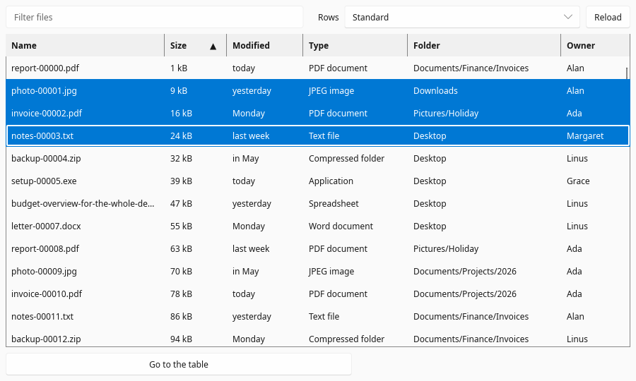

# slint-access-widgets

Accessible widgets for [Slint](https://slint.dev): built so that people who
use a screen reader or only a keyboard can use them as well as anyone else
(WCAG 2.2 AA / EN 301 549). They follow the active Slint style (fluent,
cupertino, material, cosmic), light and dark.

```
cargo add slint-access-widgets
cargo add --build slint-access-widgets
```

**Status: young (0.1).** Tested automatically with the Linux accessibility
bus (AT-SPI, what Orca reads); Windows (NVDA, Narrator) and macOS
(VoiceOver) still to be tested.



## AccessTable

A drop-in for `StandardTableView` (same `columns` and `rows`):

- **Only what is on screen exists.** 2,000 or 200,000 rows cost the same.
- **Lazy loading:** the table says which rows are on screen; fetch only
  those (from a server, another computer). Rows on their way show and read
  "Loading…". `LazyRows` (Rust) keeps track.
- **A screen reader always knows where you are**, also far down the list:
  every row says "report.pdf, Size 2 MB, Modified yesterday" (up to 24
  columns) with its position.
- **One Tab stop.** Arrows, Page Up/Down, Home/End; Enter opens; the Menu
  key or Shift+F10 opens your context menu.
- **Type to jump:** "inv" goes to the first row starting with "inv"; the
  same letter again walks through all rows with that letter.
- **Left/Right reads one cell:** "Size, 2 MB".
- **Sorting** by click or Enter on a header; **Shift+click or Shift+Enter
  adds a level** (up to three: ▲1 ▼2). Announced: "Type, sorted ascending,
  then Size, sorted descending". Your app sorts (`sort-changed`).
- **Columns:** drag the edge or Ctrl+Left/Right to resize; double click
  the edge or Ctrl and + to fit the contents. When they don't fit, the
  table **scrolls sideways** and the **first column stays in place**.
- **Several rows at once**, as in File Explorer: Shift extends, Ctrl moves
  only the focus, Space or Ctrl+click adds or removes, Ctrl+A selects all;
  "3 selected" is announced. `Selection` (Rust) keeps the **same items
  selected after sorting or filtering**.
- **Ctrl+C copies** the selected rows as tab-separated text (pastes as
  columns into a spreadsheet); "3 rows copied" is announced (feature
  `clipboard`).
- **Cut-off text gets a tooltip** with all of it, for the mouse and for the
  keyboard; it stays while you hover it, Escape closes it (WCAG 1.4.13).
- **Focus ring only when you use the keyboard** (like `:focus-visible`);
  the selection always shows.
- **Compact, standard or comfortable rows** (24 / 32 / 40 px, growing with
  the text size); **empty and loading states** that are shown and announced;
  **sticky header**.

For anything else in a row (check boxes, progress bars, …) use the building
blocks `AccessTableView`, `AccessRow` and `AccessTableHeader`, with cells
that never take focus (`AccessCheckCell`, `AccessProgressCell`,
`AccessTextCell`); see `examples/transfer`.

## AccessFilter

A quick filter field that announces "12 of 2000 shown" once you stop
typing; Escape clears it. Your app (or server) does the filtering.

## Use it

```rust
// build.rs
let config = slint_build::CompilerConfiguration::new()
    .with_library_paths(slint_access_widgets::library_paths());
slint_build::compile_with_config("ui/app.slint", config).unwrap();
```

```slint
import { AccessTable } from "@access-widgets";
```

Examples (`cargo run` in each):

| | |
|---|---|
| `examples/basic` | the smallest table: swap it in for `StandardTableView` |
| `examples/gallery` | everything: sort, filter, select, copy, density (`-- 200000` for a long table, `--lang nl` in Dutch) |
| `examples/transfer` | a list with tick boxes and progress per row, pause and cancel |
| `examples/remote` | lazy loading: 100,000 files on a slow server, searched and sorted there |

## Translations

The widgets' own words ("sorted ascending", "3 selected", …) use `@tr`
with the context `access-widgets`, and Dutch and German come with the
crate (`translations/`). With [po-bundle](https://github.com/baslentfert/po-bundle)
they are picked up and filled in by themselves; everything else (column
titles, the table's name) comes from your app.

## Testing what a screen reader gets

`scripts/a11y-test.py` starts each example in its own invisible X display
with its own accessibility bus (`scripts/headless.sh`), presses keys and
checks after every key where the focus is and what is announced, also
what lands on the clipboard:

```
scripts/headless.sh python3 -I scripts/a11y-test.py
```

`scripts/shot.sh` makes screenshots the same way. This is becoming the
`slint-a11y-check` crate.

## Not yet

Table semantics (rows, cells, column headers) for screen readers need Slint
and AccessKit ([slint#14965](https://github.com/slint-ui/slint/issues/14965));
until then rows are read as list items with their column titles. Still to
come: a menu on headers and rows, tree rows and groups, a card layout for
narrow windows, editable cells, rows of different heights, drag and drop,
right-to-left.

## Credits and licensing

Behaviour follows the W3C WAI-ARIA Authoring Practices; ideas are borrowed
from well-known web tables (see `docs/research-html-tables.md`). No code is
taken from them. MIT OR Apache-2.0.
